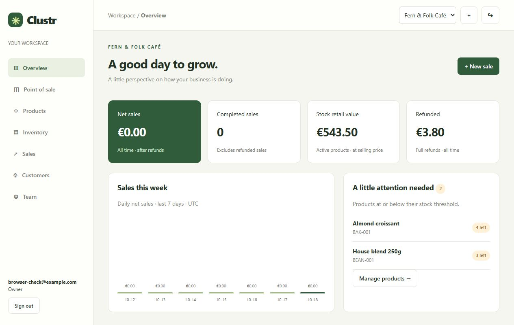

# Clustr

A practical, mid-level .NET business management app. Manage a small shop from its first product to its first sale, without setting up a fleet of services.

**Start here: [the very simple setup guide](docs/SETUP.md).** No previous .NET experience is assumed.



## What you can do

- Register, sign in, and create separate business workspaces.
- Switch between workspaces. Membership is checked on every workspace request.
- Add registered teammates as managers or cashiers; remove their access.
- Create, search, edit, and archive products with unique workspace SKUs.
- Adjust inventory with a reason and inspect its movement history.
- See low-stock products and retail stock value.
- Save customers and attach a customer to a sale.
- Use a cart to complete a simulated cash/card checkout.
- Retry checkout safely with the same request key.
- Issue a full refund, optionally returning resellable items to stock.
- Print a receipt or use the browser's Save as PDF option.
- View sales totals and a seven-day chart; export sales to CSV.
- Load sample café products into a new workspace.

## Quick start

Install the **.NET 10 SDK**. Open a terminal in this folder:

```powershell
dotnet restore Clustr.slnx
dotnet run --project src/Clustr --urls http://localhost:5080
```

Open **http://localhost:5080**. Create an account, create a workspace, open Products, and choose **Load sample café**. There is no shared default password.

The SQLite database is created automatically in `src/Clustr/App_Data`. Keep the terminal open while using the app. Press Ctrl+C to stop it. Your data remains.

## Technology and structure

ASP.NET Core 10 minimal APIs, C#, Entity Framework Core, SQLite, cookie authentication, plain JavaScript/HTML/CSS, and xUnit integration tests.

```text
src/Clustr/
  Program.cs                 HTTP routes, permissions, authentication
  Data/Models.cs             Database records
  Data/AppDb.cs              EF Core database mapping and constraints
  Services/CommerceService.cs Checkout, refunds, stock transactions
  Services/Contracts.cs      Request types and validation helpers
  wwwroot/                   Browser interface
tests/Clustr.Tests/           Tests through real HTTP endpoints + SQLite
docs/                        Setup, architecture, API, scope
```

This is deliberately one application and one test project. It teaches real backend responsibilities without dozens of layers, message brokers, or infrastructure dependencies. The original enterprise blueprint has been adapted to the requested middle-level scope. See [scope and limitations](docs/SCOPE.md) for the exact differences.

## Verification

```powershell
dotnet test tests/Clustr.Tests/Clustr.Tests.csproj
dotnet publish src/Clustr -c Release -o artifacts/app
```

Tests cover tenant isolation, staff permissions and revocation, last-item concurrency, transaction rollback, checkout retries, full refunds, historical snapshots, sign-in/sign-out, and write-header protection. Each test host uses a separate temporary SQLite database.

The GitHub Actions workflow runs tests and produces a publish artifact when this repository is pushed to GitHub. No cloud deployment is configured.

## Optional Docker

```powershell
docker compose up --build
```

Open the same local URL. Docker stores its database in the `clustr-data` volume, separate from the normal local database. `docker compose down` stops the app and preserves that volume.

## More help

- [Step-by-step setup, first sale, troubleshooting](docs/SETUP.md)
- [How the code works](docs/ARCHITECTURE.md)
- [API reference with examples](docs/API.md)
- [Implemented scope and future improvements](docs/SCOPE.md)

Clustr is a learning and portfolio application. Payments are simulated, all workspaces use EUR, and receipts are demonstration receipts.
