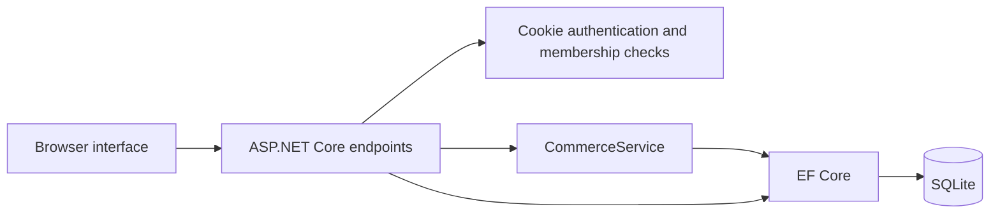

# How Clustr works

## One application, clear responsibilities

The browser downloads HTML, CSS and JavaScript from ASP.NET Core. JavaScript calls JSON endpoints on that same server. The endpoints check who you are and which workspace you belong to. EF Core reads and writes a local SQLite database.

`Program.cs` owns routes, permissions, and simple CRUD. `CommerceService` owns multi-step business operations. `Data` owns persistence. This small separation is enough for the current project. It avoids a generic repository, mediator framework, event bus, or four projects per feature.

## Tenant isolation

Every business record is associated with a workspace. Routes begin with `/api/w/{workspace}`. A route filter looks up the current user's membership in that workspace on every request. Each query also includes the workspace ID. Product and customer IDs supplied during checkout are checked against that same workspace.

The workspace ID is a selector, not proof of access. Removing a membership takes effect on the next request, even if the user's sign-in cookie is still valid. A user can belong to multiple workspaces with different roles.

The application uses explicit query scoping, not EF global filters or database row-level security. Keep the workspace predicate when adding endpoints. Tests prove isolation for the important read/write paths.

## Accounts and permissions

ASP.NET Core's password hasher stores salted password hashes. Authentication uses an HTTP-only, SameSite=Strict cookie lasting eight hours. Passwords are never returned by an endpoint. Workspaces and roles are read from the database rather than trusted from the client.

Write requests require `X-Clustr-Request: 1`. The app has no CORS policy, so another origin cannot make an authenticated browser write using this custom header without a rejected preflight. This depends on keeping CORS closed and all mutations on non-GET endpoints. Static files use a restrictive content security policy, and API responses are marked `no-store`.

The cookie becomes secure on HTTPS. Local HTTP is only for development. Login and registration have per-IP rate limits. Data-protection keys persist in the data directory's `keys` subfolder, keeping cookies valid across restarts. This starter relies on filesystem permissions for those keys; production hosting should also configure key encryption at rest. Session invalidation across devices, password recovery, MFA, and email verification are outside this edition.

## Checkout consistency

1. Validate the request key, payment method, quantities, and unique product lines.
2. Begin a database transaction before reading stock.
3. Look for a previous sale with this workspace and request key.
4. If found, compare the request fingerprint and return the same sale. A changed cart with the same key is rejected.
5. Validate the customer and products belong to this workspace.
6. Check stock and subtract quantities.
7. Store the sale, original product names/prices, and stock movements.
8. Commit everything together.

SQLite's immediate write transaction serializes competing writers. A second checkout reads stock after the first commits. Stock cannot become negative; a database check constraint also guards it. This is suitable for a small single-instance app. High-volume concurrency is a reason to migrate to PostgreSQL, with deliberate row-locking or conditional-update logic and fresh concurrency tests.

The browser keeps a pending request and its key in session storage for the current user/workspace, when available. It reuses the payload on uncertain retries. Server records persist the key indefinitely. A successful checkout or a known validation/conflict response clears the pending state. There is no offline-sale mode.

## Money, history, refunds

Amounts are integer cents stored as 64-bit integers. Product prices are limited to €1,000,000, quantities to 10,000 per line, and carts to 100 lines. These bounds keep multiplication and totals within range. The API calculates totals from current database prices rather than trusting the browser.

Historical sale lines contain name and unit-price snapshots. Products are archived rather than physically deleted. A refund marks the original sale as refunded and optionally creates matching positive stock movements. The whole refund is transactional. A second refund is rejected.

The dashboard's seven-day chart groups non-refunded sales by their original sale date in UTC. A later full refund removes the original sale from that chart. This is a simple sales view, not a financial ledger showing refunds on their refund date. Stock value uses retail prices, not purchase cost or accounting valuation.

## Database lifecycle and backups

`EnsureCreated` builds the schema on first start. This is intentionally a beginner-friendly initial schema, not a production migration system. It does not upgrade an existing database after model edits.

For disposable demo data, stop the app and move `App_Data` into a backup folder, then start with a new empty database. For data you need to retain, introduce EF migrations with a planned baseline and tested conversion; do not blindly run migrations against an `EnsureCreated` database. A schema change requires an explicit data-upgrade plan.

The database uses WAL mode. Back up the complete data directory while the app is stopped, rather than copying only the `.db` file during a write. Tests create isolated databases under the OS temporary directory.

## Deployment boundaries

The Dockerfile and Compose file provide a local container option. For public hosting, use one instance, persistent storage, HTTPS termination, an appropriate AllowedHosts setting, trusted-proxy configuration if applicable, persistent data-protection keys, backups, and a real account-recovery process. The app does not configure these hosting services for you.

Do not horizontally scale this SQLite edition or put its database on an unsuitable network filesystem. Health reports process availability; it is not a deep database readiness probe.
